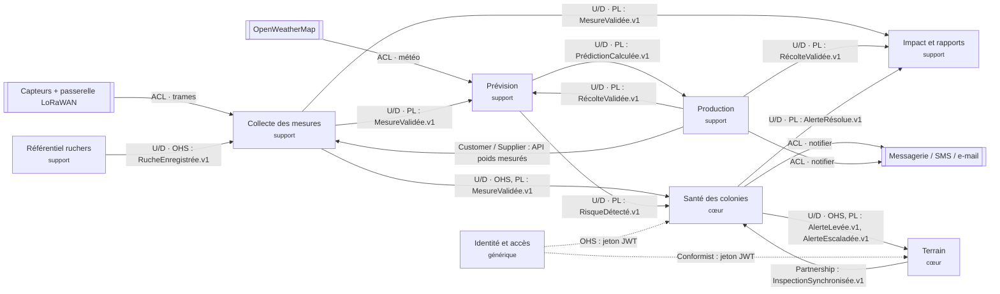

# Context map QueenBee · groupe Dev-<n>

Auteurs : Abdoul DALMEIDA, El Housseine SY

## Relations
| Amont | Aval | Relation | Échange | Justification |
|---|---|---|---|---|
| Capteurs + passerelle | Collecte | ACL | trames LoRaWAN | format binaire propriétaire, traduit en `Trame` |
| OpenWeatherMap | Prévision | ACL | météo | modèle externe non maîtrisé |
| Référentiel | Collecte | U/D · OHS | RucheEnregistrée.v1 | ne valider que les ruches connues |
| Collecte | Santé / Prévision / Impact | U/D · OHS, PL | MesureValidée.v1 | plusieurs consommateurs, contrat versionné |
| Prévision | Santé | U/D · PL | RisqueDétecté.v1 | Santé lève l'alerte |
| Prévision | Production | U/D · PL | PrédictionCalculée.v1 | calcul de l'écart de rendement |
| Production | Prévision | U/D · PL | RécolteValidée.v1 | réentraîner le modèle |
| Santé | Terrain | U/D · OHS, PL | AlerteLevée.v1, AlerteEscaladée.v1 | visite anticipée, notification |
| Terrain | Santé | Partnership | InspectionSynchronisée.v1 | l'inspection résout l'alerte ; deux équipes livrent ensemble |
| Production | Collecte | Customer / Supplier | API poids mesurés | le coordinateur compare aux poids |
| Santé / Production | Impact | U/D · PL | AlerteRésolue, RécolteValidée.v1 | indicateurs |
| Identité | Santé / Terrain | OHS / Conformist | JWT et rôles | contexte générique |
| Santé / Production | Messagerie | ACL | commande Notifier | isoler le fournisseur |
