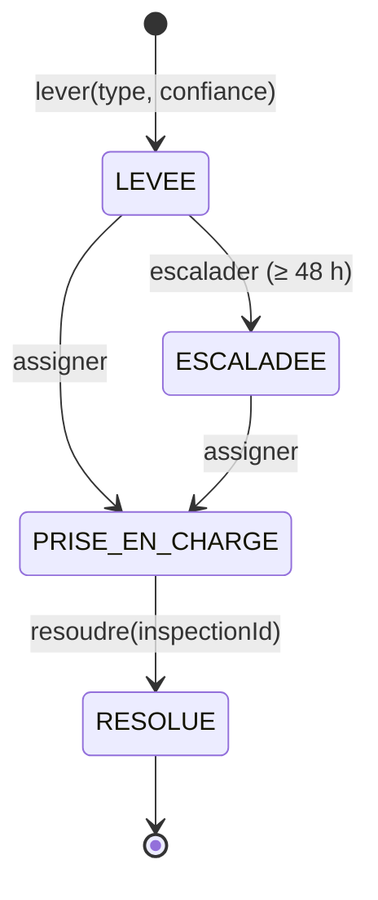

# Parcours Dev · agrégat Alerte (contexte Santé des colonies)

Auteurs : Abdoul DALMEIDA, El Housseine SY

## Diagramme d'états

## Invariants
1. Type de risque dans `TYPES_DE_RISQUE` (ESSAIMAGE, AFFAIBLISSEMENT, STRESS_THERMIQUE, MORTALITE).
2. Confiance numérique dans [0 ; 1].
3. On ne résout qu'une alerte prise en charge, avec un `inspectionId`.
4. On n'escalade qu'une alerte LEVÉE depuis 48 h ou plus.
5. Une alerte RÉSOLUE n'accepte aucune transition.

## Événements publiés
AlerteLevée · AlertePriseEnCharge · AlerteEscaladée · AlerteRésolue. L'agrégat les accumule, `pullEvents()` les vide, `AlerteService` les publie sur l'EventBus.

## Place sur la context map
- Santé des colonies publie `AlerteLevée.v1` après `RisqueDétecté.v1` de Prévision.
- Terrain consomme `AlerteLevée` (visite anticipée) et `AlerteEscaladée` (notification du coordinateur).
- Terrain renvoie `InspectionSynchronisée`, qui déclenche `resoudre(inspectionId)` (Partnership).
- Impact consomme `AlerteRésolue`.
- Distinct de `IncidentSite` (Collecte).

## Reste à faire pour le 30/10
- État ANNULÉE (fausse alerte signalée par le coordinateur) et ses tests.
- Observateur qui notifie le coordinateur du site à l'escalade.

## Vers l'ADR de spécialité
« Où vit la politique d'escalade à 48 h ? » Options : tâche planifiée (cron), file différée (délai à la publication), calcul à la lecture. Critères : fiabilité après redémarrage, simplicité, comportement en mode dégradé (`receivedAt` vs `occurredAt`).
